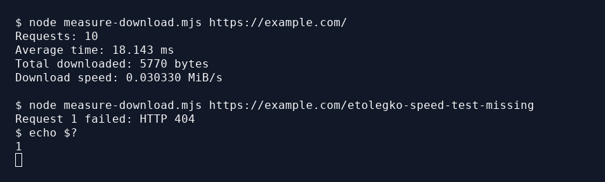

# Примеры запуска и ограничения замера



## Успешный запуск

```console
$ node measure-download.mjs https://example.com/
Requests: 10
Average time: 18.143 ms
Total downloaded: 5770 bytes
Download speed: 0.030330 MiB/s
```

Код выхода — `0`. Время и скорость меняются от запуска к запуску.

## Ошибка

```console
$ node measure-download.mjs https://example.com/etolegko-speed-test-missing
Request 1 failed: HTTP 404
$ echo $?
1
```

При HTTP-ошибке, перенаправлении, сетевом сбое или тайм-ауте CLI останавливается на текущем запросе и пишет его номер и причину в stderr. Код выхода — `1`. Повторных попыток и итоговых метрик нет, даже если предыдущие запросы прошли успешно. При неверном аргументе CLI печатает подсказку по запуску и выходит с тем же кодом.

## Большие файлы

Скрипт читает тело по частям и суммирует размеры полученных блоков. В локальном прогоне он прочитал 10 ответов по 64 МиБ, насчитал ровно 671 088 640 байт (640 МиБ) и достиг пикового RSS около 158 МиБ. Скорость на `localhost` зависит от самой машины и цикла передачи через loopback.

Предел в 60 секунд действует на весь запрос, включая скачивание тела. Например, передача 1 ГиБ при 10 МиБ/с займёт около 102 секунд, и такой запрос завершится по тайм-ауту. Измерение передаёт до десяти размеров файла, поэтому учитывайте трафик.

## Кеш и повторное использование соединения

CLI делает сетевой GET каждый раз и не хранит ответы локально. CDN или промежуточный прокси может отвечать из своего кеша. В локальной имитации с задержкой 80 мс на исходном сервере среднее снизилось с 83,7 до 10,8 мс при девяти попаданиях в кеш. Клиент получил десять одинаковых тел в обоих случаях.

Результат относится к тому адресу, который обслужил запрос. Для измерения исходного сервера укажите его прямой адрес или используйте маршрут с настроенным обходом CDN-кеша. Директива `no-cache` запрашивает перепроверку сохранённого ответа и допускает его использование после успешной перепроверки. [RFC 9111](https://www.rfc-editor.org/rfc/rfc9111.html#section-5.2.1.4)

Node.js может переиспользовать соединение. Тогда первый запрос может включать затраты на установку TCP и TLS, а последующие — проходить по уже открытому соединению. [Документация Node.js](https://nodejs.org/docs/latest-v22.x/api/http.html#class-httpagent)
